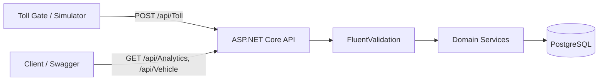

# Highway Toll & Traffic Violation System

[](https://github.com/peciiin/HighwayTollsystem/actions/workflows/ci.yml)

.NET 8 REST API backend simulating an automated highway toll collection and traffic enforcement system with vehicle registration checks, violation detection, traffic analytics, and automated testing. Built with PostgreSQL and Docker containerization.

## About Project

- **Automated Toll Calculation:** Dynamic fee calculation based on vehicle category (`Truck`, `Other`, `Car`, `Motorcycle`, `EV`).
- **Traffic Violation Detection:** Automated evaluation upon each toll gate passage:
  - **Speeding:** Differentiated limits (`90 km/h` for trucks, `130 km/h` for cars) with radar tolerance calculation and tiered penalties.
  - **Vignette Validation:** Verifies active electronic vignettes for non-exempt vehicles.
  - **Technical & Emission Inspections:** Validates STK and emission expiration dates.
  - **Unregistered Vehicles:** Flags unknown license plates passing through gates.
- **Vehicle Management & Filtering:** Endpoints for registering new vehicles and querying vehicle or passage records with filtering support.
- **Real-Time Traffic Simulator:** Background worker (`TollSimulatorService`) continuously generating realistic highway passages and violations every 5 seconds.
- **Analytics & Reporting:** Dedicated endpoints for dashboard metrics, top-performing toll gates, and violation breakdowns.
- **Production-Ready Patterns:** FluentValidation, Global Exception Handling (`GlobalExceptionHandler` with `ProblemDetails`), Health Checks (`/health`), and automated EF Core migrations + database seeding (`DbSeeder`).

## Tech Stack

- **Framework:** .NET 8 / ASP.NET Core Web API
- **Database:** PostgreSQL 16 + Entity Framework Core (Code-First Migrations)
- **Validation & Error Handling:** FluentValidation, `IExceptionHandler`, `GlobalExceptionHandler`
- **Testing:** xUnit, FluentAssertions (Unit tests for services & validators, Integration tests for controllers)
- **DevOps & CI:** Docker, Docker Compose, GitHub Actions

## Architecture Diagram



## How to Run the App

### 1. Clone Repository
```bash
git clone https://github.com/peciiin/HighwayTollsystem.git
cd HighwayTollsystem
```

### 2. Build and Run Containers
```bash
docker compose up --build
```

### 3. Explore API
- **Swagger UI:** `http://localhost:8080/swagger`
- **Health Check:** `http://localhost:8080/health`

## Run Tests

```bash
dotnet test
```

## Main API Endpoints

- **`POST /api/Toll`** – Register a vehicle passage and evaluate tolls and traffic violations
- **`GET /api/Vehicle`** – Query registered vehicles with filtering support
- **`POST /api/Vehicle`** – Register a new vehicle
- **`GET /api/Vehicle/{id}`** – Get detailed information about a specific vehicle by ID
- **`GET /api/Analytics/dashboard`** – Overall traffic, revenue, and penalty metrics
- **`GET /api/Analytics/top-gates`** – Toll gates ranked by passage count and collected fees
- **`GET /api/Analytics/breakdown-violations`** – Violation statistics grouped by violation type
- **`GET /health`** – Application and PostgreSQL database health status